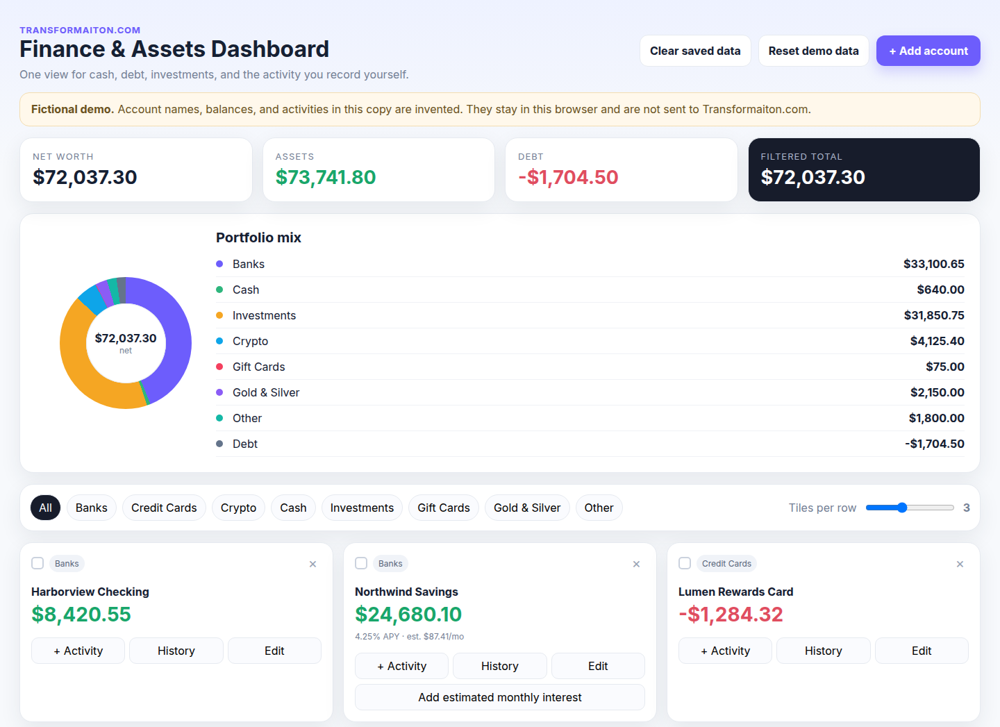
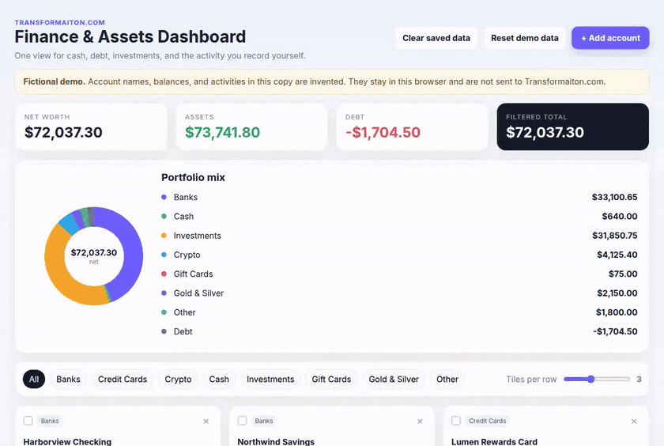
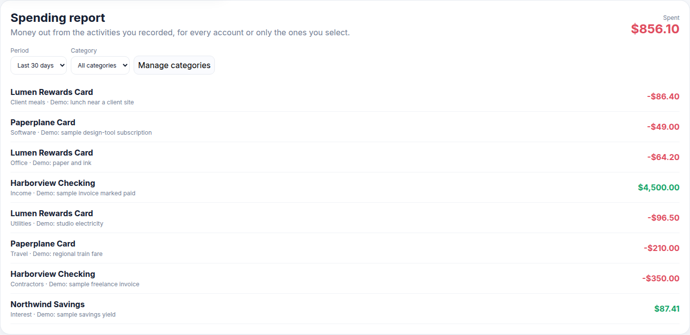
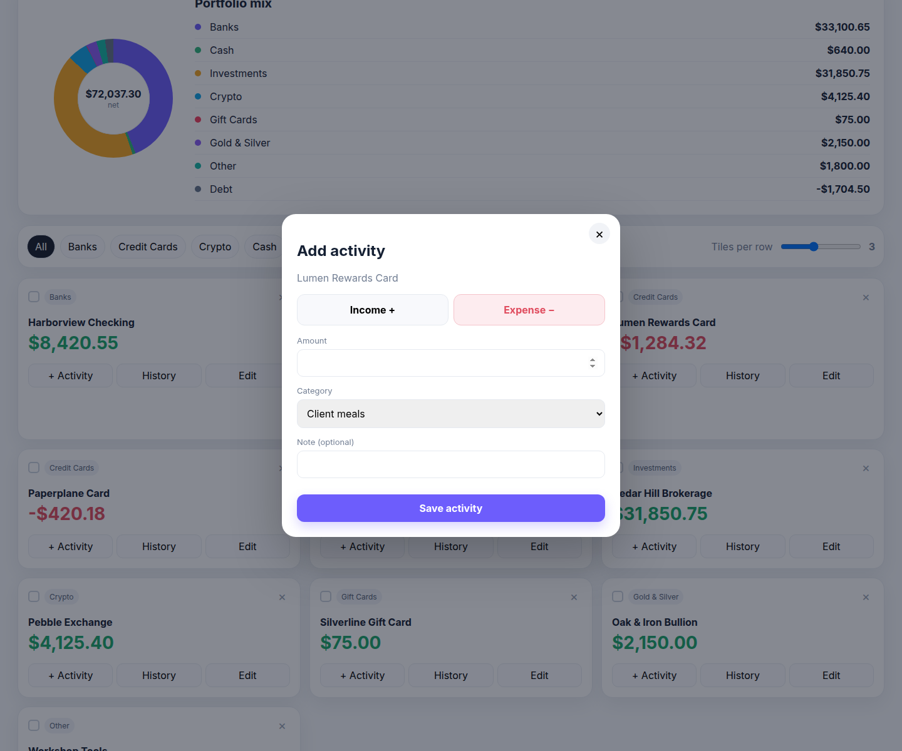

# Finance & Assets Dashboard by Transformaiton.com

A browser-based dashboard for people who want one clear view of cash, debt, investments, and day-to-day money movement. You type the balances yourself. This public copy opens with a **fictional demo portfolio**, so you can click through the product before entering anything of your own.

Built by [Transformaiton.com](https://transformaiton.com/), an AI consultancy for small businesses. The spelling **Transformaiton** is intentional.





## What it does

The dashboard is a manual ledger with a visual summary on top.

- **Net worth, assets, and debt** sit in one row. Credit-card balances are stored as negative numbers, so debt is visible instead of being mixed into cash.
- **A portfolio mix** shows how positive balances split across banks, cash, investments, crypto, gift cards, metals, and other assets, with debt called out on its own.
- **Account cards** cover the institutions and places you track by hand. Each card can record money in, money out, and a running history.
- **A spending report** totals money out by period and category, for every account or only the ones you select.

Figures in the published demo are invented. Names such as Harborview Checking, Northwind Savings, and Lumen Rewards Card are not real accounts. Edits you make stay in that browser. They are not uploaded to Transformaiton.com.

## Features

- Accounts for banks, credit cards, crypto, cash, investments, gift cards, metals, and other assets
- Add, edit, reorder, and delete accounts
- Positive or negative activity with a category and an optional note
- Per-account history
- Filter by account type, with a total for the accounts on screen
- Select any mix of accounts and limit the grid and the report to that mix
- Drag and drop to reorder cards
- One to six cards per row on a wide screen
- Spending report for the last day, last week, last 30 days, or all time
- Custom categories
- Optional APY, an estimated monthly interest amount, and a button that records that estimate
- Responsive layout for a desktop window and a phone
- **Reset demo data** and **Clear saved data** controls
- English interface

## Tech stack

| Piece | Choice |
| --- | --- |
| Framework | [Next.js](https://nextjs.org/) 16 (App Router) |
| UI | React 19 |
| Storage | Browser `localStorage` (keys prefixed with `tfa_finance_`) |
| Server, database, and accounts | None in this version |
| Language | JavaScript |

There is no bank-link integration in this repository. A hosted copy still keeps each visitor's numbers on their own device.

## Requirements

- Node.js 20.9 or newer
- npm 10 or newer
- A current version of Chrome, Firefox, Safari, or Edge

No API key, database, or Transformaiton.com login is required.

## Install and run

The full guide, including a production build, deployment notes, and troubleshooting, is in [docs/INSTALL.md](docs/INSTALL.md).

```bash
git clone https://github.com/Transformaiton/APP-finance-assets-dashboard.git
cd APP-finance-assets-dashboard
npm install
npm run dev
```

Open http://localhost:3000. Leave the terminal running while you use the app.

To check the production build locally:

```bash
npm run build
npm start
```

## Configuration

This version is intentionally unconfigured.

- Do not create a `.env` file for normal use. There is no secret to set.
- `.gitignore` already ignores `.env`, `.env.*` (except a future `.env.example`), and common key and certificate filenames. Keep real credentials out of the repository.
- The fictional portfolio lives in [`app/demo-data.js`](app/demo-data.js). Change it only to adjust the sample, and keep any published sample fictional.
- Amounts are displayed in US dollars.
- The app does not import older `mmd_` browser data from earlier copies of this project.

## Usage

Step-by-step instructions are in [docs/USAGE.md](docs/USAGE.md). The short version:

1. Open the app and read the amber **Fictional demo** banner.
2. Use the totals, the portfolio mix, and the account cards to move around the sample studio.
3. Click **+ Activity** on a card to record an expense or an income. The balance and the spending report update immediately.
4. Use the type chips, the card checkboxes, and **Tiles per row** to narrow and rearrange the view.
5. Open **History** on a card, or change the period and category in **Spending report**.
6. Click **Clear saved data** when you want an empty portfolio, then **+ Add account** to enter your own figures. Click **Reset demo data** to bring the fictional sample back.

Give accounts a nickname. Do not put a full account number, card number, or routing number in a name or a note.





## FAQ

**Is the spelling "Transformaiton" a typo?**
No. Transformaiton.com is the company name.

**Are the balances in the repo real?**
No. The portfolio shipped in this repository is fictional. It exists so the screenshots, the spending report, and a first visit all have something to show.

**Where is my data stored?**
In this browser, under `localStorage` keys that start with `tfa_finance_`. Nothing is sent to a server when you add an account or an activity. Another device will not see those edits.

**Can more than one person share a portfolio?**
Not in this version. There is no login and no sync. Each browser has its own copy.

**Does "Add estimated monthly interest" talk to a bank?**
No. It multiplies a positive balance by the APY you typed, divides by 12, and records that estimate as an Interest activity when you click the button.

**Why does debt look negative?**
A credit card you owe is stored as a negative balance. The Debt total repeats that amount as a negative number so it is not mistaken for cash.

**Can I use this for my own business?**
Yes. Clear the demo data and enter the balances you want to track. On a shared computer, clear the browser site data when you are finished. If you change `app/demo-data.js`, do not publish real customer or account details.

**The page still shows my old edits. How do I get the demo back?**
Click **Reset demo data** and confirm. That replaces whatever this browser saved with the fictional portfolio.

## Contact

Transformaiton.com helps small businesses put practical AI to work.

- Website: [https://transformaiton.com/](https://transformaiton.com/)
- Email: [info@transformaiton.com](mailto:info@transformaiton.com)
- GitHub: [https://github.com/Transformaiton](https://github.com/Transformaiton)
- Office: 333 S. Beaudry St, Los Angeles, CA

## License

[MIT](LICENSE). Copyright (c) 2026 Transformaiton.com.
